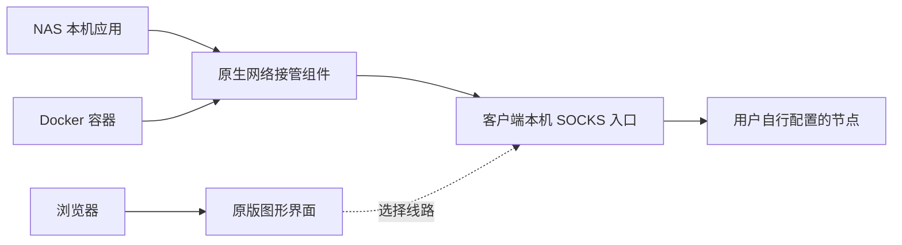

<p align="center">
  
</p>

<p align="center">
  <strong>保留原版 v2rayN 图形界面，通过浏览器管理飞牛 NAS 的代理网络。</strong>
</p>

<p align="center">
  <a href="https://github.com/CyberShadowX/v2rayN-For-FNOS/releases/tag/v1.0.5"><strong>下载公开预览版</strong></a> ·
  <a href="docs/INSTALL.md">安装指南</a> ·
  <a href="docs/UPDATE.md">更新与回滚</a> ·
  <a href="docs/BUILD.md">自行构建</a> ·
  <a href="docs/FAQ.md">常见问题</a>
</p>

> **当前为 v1.0.5 公开预览。** 通用化封装完成本机测试与打包校验，尚未在 NAS 上重新完成整套实机验收。1.0.4 的历史实测与本次公开版的验证范围分别记录，详见 [验证说明](docs/VALIDATION.md)。

## 你可以获得什么

| 能力 | 说明 |
| --- | --- |
| 原版图形界面 | 原生运行官方 Linux v2rayN 桌面程序，通过 HTTPS 网页桌面操作 |
| NAS 与 Docker 网络接管 | 通过独立原生网络组件，将需代理的流量交给客户端选中的线路 |
| 接管互斥 | 两个客户端的界面可同时打开，同一时间只有一个应用接管 NAS 网络 |
| 完整上游更新 | 封装入口更新客户端整包、随附内核/资源及独立网络组件 |
| 更新与配置回滚 | 程序切换与配置快照配合，保留恢复入口 |
| 可检查的源码 | 提供封装源码、构建流程、第三方来源和校验材料 |

本仓库提供社区维护的 fnOS 封装，与上游项目及飞牛官方没有隶属关系。节点由使用者自行配置；仓库与安装包不提供节点、订阅或通用登录口令。

## 界面预览


*截图来自 1.0.4 的历史 NAS 实机记录，节点与日志已经脱敏。图片展示界面布局，不表示 1.0.5 已重新完成实机验收。*

## 平台与版本

| 项目 | 本次公开预览 |
| --- | --- |
| 发布版本 | v1.0.5（飞牛封装版本） |
| 目标系统 | fnOS 1.2.1010 / Debian 12 |
| CPU 架构 | x86_64 / amd64；不提供 ARM 安装包 |
| 随包 v2rayN | 7.25.6 |
| 独立网络组件 | Mihomo 1.19.34 |
| 网页入口 | HTTPS 18111 |
| 安装格式 | FPK 原生应用，运行本应用不依赖 Docker |

其他 fnOS 版本、其他 Linux 发行版及 ARM 尚未验证。文件名中的 `x86` 是飞牛包架构标记，应用载荷为 64 位 x86_64。

## 三步开始

1. 在 [v1.0.5 发布页](https://github.com/CyberShadowX/v2rayN-For-FNOS/releases/tag/v1.0.5) 下载 `fnv2rayn-1.0.5-x86.fpk`，核对同页的 SHA-256 校验清单，再通过飞牛应用中心手动安装。
2. 点击飞牛桌面图标，或打开下面的 HTTPS 入口。首次生成的是设备自签名证书，需先核对自己的 NAS 地址。登录资料的读取方法见 [安装指南](docs/INSTALL.md#首次打开与登录)。
3. 在原版客户端中选择并激活节点，然后开启右侧的 **NAS 网络** 接管。客户端内部 TUN 与系统代理保持关闭或不改变。

```text
https://<NAS地址>:18111/
```

同时安装 [Clash Verge Rev 的飞牛封装](https://github.com/CyberShadowX/Clash-Verge-For-FNOS) 时，切换前先关闭当前接管，再启用另一个。容器无需逐个设置 `HTTP_PROXY`。

## 网络如何连接



管理与局域网相关流量由封装的绕过规则处理。请使用自己已有的可信远程管理网络，并在维护前确认恢复入口。家庭网关功能尚未配置。

## 两种更新各负责什么

| 操作 | 范围 |
| --- | --- |
| 右侧“检查更新 / 一键更新” | 官方稳定客户端、随附内核/资源及独立 Mihomo 网络组件 |
| 在飞牛应用中心升级 FPK | fnOS 封装、网页管理、生命周期与适配逻辑 |

上游更新不会改变 FPK 封装版本号。更新、重启和回滚可能短暂中断网页桌面与外网连接；具体步骤见 [更新与回滚](docs/UPDATE.md)。

## 文档导航

| 需要做什么 | 从这里进入 |
| --- | --- |
| 安装、登录、导入配置 | [安装指南](docs/INSTALL.md) |
| 更新、切换客户端、回滚 | [更新与回滚](docs/UPDATE.md) |
| 准备源码与本机构建 | [构建说明](docs/BUILD.md) |
| 排查界面和网络问题 | [常见问题](docs/FAQ.md) |
| 查看实测范围与限制 | [验证说明](docs/VALIDATION.md) |
| 查看许可和上游来源 | [第三方软件与对应源码](docs/THIRD_PARTY.md) |
| 反馈问题或参与改进 | [贡献指南](CONTRIBUTING.md) · [安全报告](SECURITY.md) |

封装代码使用 [GPLv3 许可证](LICENSE)，第三方组件保留各自许可证与版权声明。上游项目：[2dust/v2rayN](https://github.com/2dust/v2rayN)。
