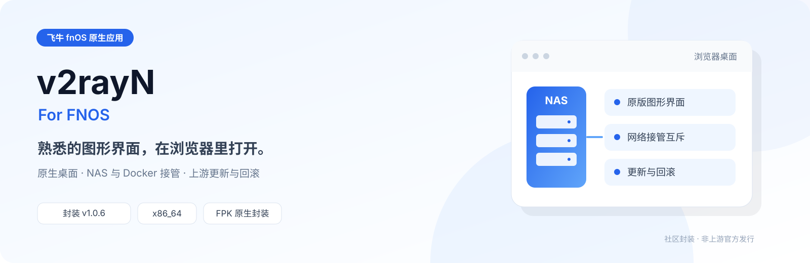
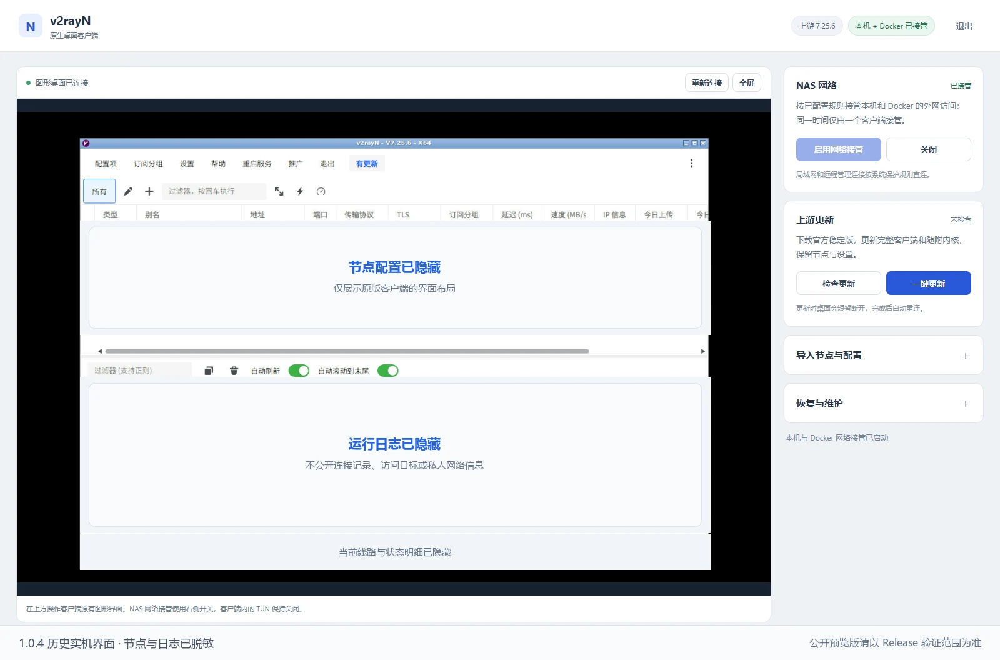
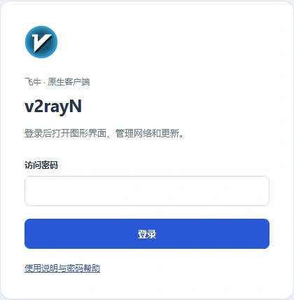
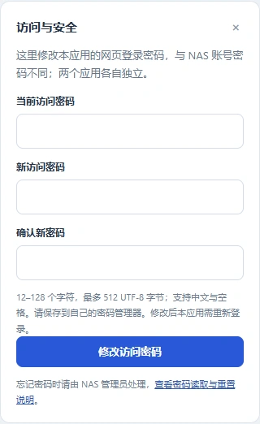

  

  <strong>熟悉的 v2rayN 图形界面，在浏览器中管理 NAS 与 Docker 网络。</strong>

  <a href="https://github.com/CyberShadowX/v2rayN-For-FNOS/releases/tag/v1.0.6"><strong>下载 v1.0.6</strong></a> ·
  <a href="docs/INSTALL.md">安装指南</a> ·
  <a href="docs/USER_GUIDE.md">模式与日常使用</a> ·
  <a href="docs/ACCESS.md">访问密码</a> ·
  <a href="docs/UPDATE.md">更新与回滚</a>

v1.0.6 新增网络接管开关、原生应用图标和网页访问密码管理。[查看更新与验证范围](docs/VALIDATION.md)。

## 功能一览

| 能力 | 说明 |
| --- | --- |
| 原版图形界面 | 原生运行官方 Linux v2rayN，通过 HTTPS 网页桌面操作 |
| NAS 与 Docker 接管 | 独立原生 TUN 配合客户端路由，按规则选择直连或节点 |
| 单一网络开关 | 灰色关闭、蓝色启用，启停过程与后台实际状态同步 |
| 接管互斥 | 两个客户端界面可同时打开，同一时间仅一个接管 NAS 网络 |
| 访问密码管理 | 每应用独立密码，支持网页修改和管理员重置 |
| 上游更新与回滚 | 客户端整包、随附内核/资源及独立网络组件一起管理 |

这是社区维护的 fnOS 封装，与飞牛或上游项目没有隶属关系。节点与订阅由使用者自行准备。

## 界面预览

查看登录页与访问密码设置

  
  

左侧为登录页，右侧为“访问与安全”的改密表单。两个应用的访问密码独立；首次读取、保存与忘记密码处理见[密码指南](docs/ACCESS.md)。

## 平台与版本

| 项目 | 配置 |
| --- | --- |
| 封装版本 | v1.0.6 |
| 本轮实测系统 | fnOS 1.2.1011 / Debian 12 |
| 最低 fnOS 声明 | 1.2.1010（manifest） |
| CPU 架构 | x86_64 / amd64 |
| 随包 v2rayN | 7.25.6 |
| 独立网络组件 | Mihomo 1.19.34 |
| HTTPS 入口 | 18111 |
| 安装格式 | FPK 原生应用 |

文件名中的 `x86` 是飞牛包架构标记，载荷为 64 位 x86_64。其他系统和 ARM 的支持范围见[验证说明](docs/VALIDATION.md)。

## 三步开始

1. 从 [Release](https://github.com/CyberShadowX/v2rayN-For-FNOS/releases/tag/v1.0.6) 下载 `fnv2rayn-1.0.6-x86.fpk`，核对同页 SHA-256 清单，再通过飞牛应用中心手动安装。
2. 点击飞牛桌面图标，或打开 `https://<NAS地址>:18111/`。由管理员读取应用生成的访问资料并登录，详见[访问密码](docs/ACCESS.md)。
3. 在原版客户端导入并激活可用线路，按下面的推荐设置开启右侧 **NAS 网络**。

| 设置 | 推荐值 |
| --- | --- |
| 原版客户端内置 TUN | 关闭 |
| 原版客户端系统代理 | 不改变系统代理 |
| 路由／代理模式 | V4—绕过大陆（Whitelist） |
| 右侧 NAS 网络 | 需要接管 NAS 与 Docker 时开启 |

V4 是路由规则版本，与 IPv4／IPv6 开关不同。若 NAS 中曾自动配置系统代理，先清除一次，再选择不改变系统代理。

两个软件之间切换时，先关闭当前接管，再开启 [Clash Verge Rev](https://github.com/CyberShadowX/Clash-Verge-For-FNOS) 的接管。完整解释见[模式与日常使用](docs/USER_GUIDE.md)。

## 两种更新

| 操作 | 更新范围 |
| --- | --- |
| 右侧“检查更新／一键更新” | 官方客户端、随附内核/资源及独立网络组件 |
| 飞牛应用中心安装新版 FPK | 网页界面、网络管理、密码管理和封装逻辑 |

上游更新不会改变 FPK 版本号；网页新功能通过新版 FPK 交付。更新和回滚步骤见[更新指南](docs/UPDATE.md)。

## 文档与反馈

| 需要做什么 | 文档 |
| --- | --- |
| 安装和首次打开 | [安装指南](docs/INSTALL.md) |
| 选择 TUN、系统代理、路由与导入格式 | [使用指南](docs/USER_GUIDE.md) |
| 读取、保存、修改和重置访问密码 | [密码指南](docs/ACCESS.md) |
| 更新、切换与回滚 | [更新指南](docs/UPDATE.md) |
| 自行构建 | [构建说明](docs/BUILD.md) |
| 排查问题 | [常见问题](docs/FAQ.md) |
| 查看平台验证和已知问题 | [验证说明](docs/VALIDATION.md) |
| 查看许可和对应源码 | [第三方来源](docs/THIRD_PARTY.md) |
| 反馈或贡献 | [问题模板](https://github.com/CyberShadowX/v2rayN-For-FNOS/issues/new/choose) · [贡献指南](CONTRIBUTING.md) · [安全报告](SECURITY.md) |

封装代码使用 [GPLv3 许可证](LICENSE)，第三方组件保留各自版权和许可。上游项目：[2dust/v2rayN](https://github.com/2dust/v2rayN)。
