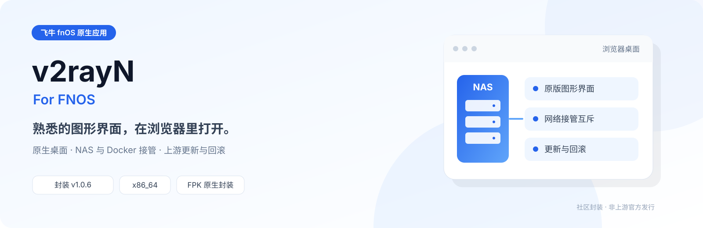

# v2rayN For FNOS v1.0.5 · 公开预览

在飞牛中原生运行 v2rayN，通过浏览器使用原版图形界面，并管理 NAS 本机与 Docker 的网络接管。

**这是公开预览版。** 1.0.5 的通用化封装完成本机测试与打包校验后发布，尚未在 NAS 上重新执行完整安装、升级、图形与网络验收。1.0.4 的历史实测不作为本版本已实机验收的声明。

## 下载与平台

| 项目 | 说明 |
| --- | --- |
| 安装包 | `fnv2rayn-1.0.5-x86.fpk` |
| 目标平台 | fnOS 1.2.1010 / Debian 12 / x86_64 |
| v2rayN | 7.25.6 |
| 独立网络组件 | Mihomo 1.19.34 |
| 网页入口 | HTTPS 18111 |
| 其他平台 | ARM、其他系统及其他 fnOS 版本未验证 |

从 [本次 Release](https://github.com/CyberShadowX/v2rayN-For-FNOS/releases/tag/v1.0.5) 下载 FPK，按同页 `SHA256SUMS.txt` 核对摘要。构建清单、封装源码及第三方对应源码资料与二进制一并提供说明。

## 本次公开整理

- 设备证书初始化通用化，去除个人部署地址，已有证书与口令保留。
- 接管前发现本机默认网卡、私有网关与可用的 Tailscale 管理路径；发现失败会拒绝接管。多默认出口、无私有网关与 IPv6-only 尚不支持自动接管；新发现逻辑未作 NAS 实机复测。
- 公开源码使用独立历史，构建输入和工具通过固定来源及哈希准备。
- 增加中文图文说明、脱敏界面图、安装/更新/回滚/构建指南与问题模板。
- 保留原版图形客户端、原生网络组件、接管互斥与封装的更新恢复流程。

## 安装与使用

1. 核对目标架构和安装包摘要，通过飞牛应用中心手动安装。
2. 打开飞牛桌面图标或自己的 NAS HTTPS 入口，并按 [安装指南](https://github.com/CyberShadowX/v2rayN-For-FNOS/blob/main/docs/INSTALL.md) 读取设备上生成的访问资料。
3. 在原版客户端导入并选择自己的线路；保持客户端内置 TUN 与系统代理关闭或不改变，再开启右侧 **NAS 网络**。

两个客户端的图形界面可以同时运行，NAS 网络接管互斥。更新与回滚可能短暂中断界面和外网；回滚会恢复相应配置快照，先保存希望保留的后续变更。

## 验证与限制

本次发布以附带的源码检查、构建清单和 SHA-256 为本机验证依据，完整边界见 [验证说明](https://github.com/CyberShadowX/v2rayN-For-FNOS/blob/main/docs/VALIDATION.md)。保留的限制包括守护恢复后摘要可能滞后、整机重启与主控强杀未验、QUIC/视频未验、原生远端 IPv6 出口未验、未来跨版本兼容性待验证，以及家庭网关尚未配置。

节点与订阅由使用者自行准备，安装包不包含个人节点或通用密码。这是社区封装，非上游或飞牛官方发行；第三方许可与对应源码见 [来源说明](https://github.com/CyberShadowX/v2rayN-For-FNOS/blob/main/docs/THIRD_PARTY.md)。

## 同页附件

| 文件 | 用途 |
| --- | --- |
| `fnv2rayn-1.0.5-x86.fpk` | 飞牛手动安装包，载荷为 Linux x86_64 |
| `SHA256SUMS.txt` | 安装包、源码和说明附件的 SHA-256 |
| `build-inventory.json` | 最终 FPK 中的文件摘要与结构检查 |
| `SOURCES.json` | 固定上游来源和对应源码归档摘要 |
| `v2rayN-For-FNOS-1.0.5-corresponding-source.tar.gz` | 本项目封装源码、构建资料和随包主要上游组件的固定源码归档 |
| `RELEASE_NOTES_zh-CN.md` | 本页中文说明的离线副本 |

本次 Windows 主会话测试 158 项：151 项通过、7 项 Linux/POSIX 检查跳过；源码检查工作流另见仓库 Actions 的实际运行结果。
