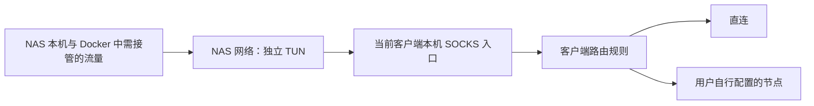

# 使用指南：TUN、系统代理与路由

[返回首页](../README.md) · [访问密码与保存](ACCESS.md)

本指南适用于飞牛封装 **1.0.6**，同时说明 v2rayN 与 Clash Verge Rev 的用法。原版客户端在左侧运行，右侧由封装管理 NAS 网络、上游更新和访问密码；页面顶部或登录页的 **使用说明** 可打开随安装包提供的离线帮助。

## 日常推荐设置

| 设置 | v2rayN | Clash Verge Rev |
| --- | --- | --- |
| 客户端内置 TUN／虚拟网卡模式 | 关闭 | 关闭 |
| 客户端系统代理 | 不改变系统代理 | 关闭 |
| 客户端路由／代理模式 | V4—绕过大陆（Whitelist） | 规则模式（Rule） |
| 右侧 NAS 网络 | 需要接管 NAS 与 Docker 时开启 | 同左；两个应用只能由一个持有接管 |

先在原版客户端中选择并激活可用节点，再打开右侧 **网络接管** 开关。客户端自己的 TUN 保持关闭，由封装统一管理虚拟网卡、DNS、接管互斥及恢复流程。

Clash 的分流由导入配置的 `rules` 决定。规则模式需要配置实际的直连、代理及匹配规则；只有节点列表时，不会自动产生完整的大陆绕过策略。

## 三个设置各负责什么

| 设置 | 负责的事情 |
| --- | --- |
| TUN | 通过虚拟网卡和系统路由接管流量，包括通常不读取桌面系统代理的程序 |
| 系统代理 | 告诉遵循操作系统代理设置的应用使用代理入口 |
| 路由规则 | 决定已经进入代理客户端的流量走直连还是节点 |

打开右侧 **NAS 网络**，会由封装的独立原生 TUN 组件把需接管的 NAS 本机与 Docker 流量交给客户端的本机 SOCKS 入口，再由客户端按规则选择出站。关闭客户端内置 TUN 后，这条链路仍可工作。

开启 TUN 不等于所有网站都通过远端节点访问。日常使用 V4 绕过大陆或合适的 Clash 规则，可让规则匹配到的国内流量直连、需代理的流量走节点。

## v2rayN 的系统代理怎么选

飞牛封装中选择 **不改变系统代理**。如果此前在 NAS 的 v2rayN 里选过 **自动配置系统代理**，先执行一次 **清除系统代理**，再切回 **不改变系统代理**。

“不改变”保留现有设置，不会清除旧代理。右侧 **NAS 网络** 是统一接管开关，单独清除系统代理不会关闭它。

Windows 电脑上原先使用的 **自动配置系统代理＋V4 绕过大陆** 可以继续保持；NAS 里的客户端运行在独立应用用户环境中，自动配置该桌面用户的系统代理并不能自动覆盖 NAS 服务或 Docker 容器。

V4 表示路由规则版本，与 IPv4／IPv6 开关是不同设置。分流是否合适还取决于所用规则、DNS、节点和目标网站；需要排查某站点时可临时比较其他路由模式，检查后恢复日常规则。

## 按使用场景开关

| 使用场景 | 操作 |
| --- | --- |
| NAS 本机和 Docker 普遍需要按规则使用代理 | 选择可用节点，开启当前客户端右侧 NAS 网络 |
| 临时恢复系统原有联网方式 | 关闭 NAS 网络；已经手动配置代理的应用需另外处理 |
| 只让指定本机程序使用代理 | 关闭 NAS 网络，在该程序内显式配置本机代理入口 |
| 只让指定容器使用代理 | 关闭 NAS 网络，另外配置容器可访问且受访问限制的代理入口 |

默认客户端代理监听在 NAS 的回环地址。普通 Docker 容器中的 `127.0.0.1` 指向容器自身，不能直接当作 NAS 代理地址。容器的独立代理入口需要另行配置；不要把默认回环端口直接写成局域网可用服务。

## 网络开关和状态

- **未启用**：灰色，圆点在左。
- **已启用**：蓝色，圆点在右，状态来自后台确认结果。
- **正在启用／正在关闭**：操作尚未完成，等待结果后再操作。
- **状态待确认／待恢复**：先检查提示和管理连接，等待状态重新确认；不要凭开关颜色推断已经恢复直连。
- **由另一客户端接管**：先在对应客户端关闭 NAS 网络，再启用当前客户端。

刷新页面后，开关按后台实际状态回显。网络接管的启用状态与原版图形界面是否已连接是不同信息；仅看到图形窗口，不代表 NAS 网络已接管。

## 在两个客户端之间切换

1. 关闭当前接管应用的 **NAS 网络**。
2. 等待确认原接管已退出；若提示待恢复，先处理恢复状态。
3. 在另一个客户端选择并激活可用线路。
4. 开启该应用的 NAS 网络，核对开关、接管者以及本机和容器的实际访问。

两个原版图形客户端可以同时运行，网络接管互斥。局域网与可信管理相关流量由封装的绕过和管理路径检查保护。

## 导入节点与配置

| 客户端 | 网页导入格式 | 使用方法 |
| --- | --- | --- |
| v2rayN | 节点分享链接（每行一条） | 粘贴客户端支持的 VMess、VLESS、Trojan、Shadowsocks 等链接，由原版客户端处理；按原版窗口的结果确认 |
| Clash Verge Rev | Clash / Mihomo YAML | 导入含 `proxies` 的配置；按需包含 `proxy-groups`、`rules` 等内容，再在原版界面选择线路 |

协议名称与导入文件格式不是同一件事。Clash 的 YAML 可以描述多种协议；网页中选择 YAML 不表示只能使用某一种节点协议。具体协议与参数组合以对应客户端和内核支持为准。

导入内容只提交给本 NAS 应用，不发往在线转换服务。不要把节点、订阅或完整配置贴进公开 Issue、日志、文档和截图。

## 两种更新怎么区分

| 更新方式 | 更新内容 |
| --- | --- |
| 网页右侧“检查更新／一键更新” | 官方稳定客户端完整发行包、随附内核与资源、独立网络组件 |
| 飞牛应用中心安装新版 FPK | 飞牛封装、右侧网页、网络管理、密码管理和安装生命周期逻辑 |

右侧网页的新功能需要新 FPK。上游更新不会改变 FPK 封装版本号。使用封装更新入口，让程序切换、配置快照和回滚配合；更新期间桌面和代理连接可能短暂中断。

## 密码和恢复入口

网页登录密码由每个应用独立生成，与 NAS 管理账号密码不同。首次读取、保存、网页改密、忘记密码和卸载保留规则见 [访问密码与保存](ACCESS.md)。

停止、重启、升级、回滚和卸载通过飞牛应用中心或封装入口操作，让网络与子进程完成收尾。恢复程序版本时先保存需要保留的配置变化，不要把 `current`、`previous` 引用或配置快照当作临时文件清理。
